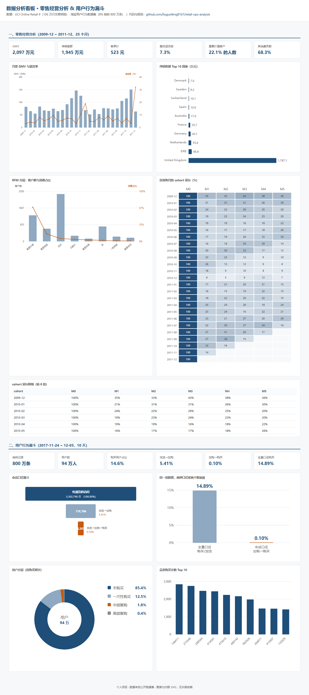

# 零售经营分析 · 用户行为漏斗

两个基于公开数据集的分析项目，覆盖交易侧经营分析与用户侧转化留存。全部代码可复现：
下载数据后一条命令即可跑出文中所有数字。

| 项目 | 回答的问题 | 数据 | 主要方法 |
|---|---|---|---|
| [零售经营分析](A_零售经营分析) | 增长质量如何？退货和客户结构有什么问题？ | UCI Online Retail II，约 100 万行交易明细 | 口径定义、月度/国家拆解、RFM 分层、cohort 留存 |
| [用户行为漏斗](B_行为漏斗) | 用户在哪一步流失？留存靠不靠得住？ | 淘宝用户行为数据集，约 1 亿条行为 | 会话漏斗、同期群留存、用户分层、A/B 实验设计 |

**产出**：[可视化看板](dashboard/index.html)（单文件，无外部依赖）· [报告 A](report/A_零售经营分析_报告.pdf) · [报告 B](report/B_用户行为分析_报告.pdf)



---

## 项目一：零售经营分析

**背景**　一家英国在线零售商的 2009–2011 年交易明细，含真实退货单。目标是把原始明细整理成经营口径，
判断「增长是质量型还是靠促销堆出来的」。

**做法**

1. **清洗**：统一列名 → 转类型 → 金额用「数量 × 单价」重算（不信任原表金额列）→ 标记退货（发票号以 `C` 开头**或**数量为负）→ 剔除单价 ≤ 0 的行
2. **口径**：GMV、净销售额、订单数、客单价、退货率、复购率、RFM、cohort 留存，每个都在报告的口径章节里写了公式、理由和常见坑
3. **拆解**：月度趋势 → 异常月份 → 国家与商品下钻 → 客户结构与留存

**主要发现**（2009-12 – 2011-12，共 25 个月）

- GMV 2,097 万元、净销售额 1,945 万元、订单 40,077 笔、客单价 523.31 元，整体退货率 7.3%
- 6 个月出现「GMV 环比增长、退货率同步上升」；其中 2010-03 GMV 环比 +50.6%、退货率环比上升 4.5 个百分点，进一步下钻到国家与商品定位来源
- RFM 分层：22.1% 的重要价值客户贡献 68.3% 的销售额；复购率 72.4%，但该数据客户以批发型为主，这个指标天然偏高，已在报告中说明，不作为亮点

**产出**　`outputs/A_零售经营分析.xlsx`（4 张结果表 + 图表）；完整分析见 [报告 A](report/A_零售经营分析_报告.pdf)。

**局限**　原始数据没有成本字段，因此**不做毛利率、利润率**——这是刻意的取舍，不是遗漏。
退货口径假设「C 前缀或负数量」都算退货，未考虑促销日历。

---

## 项目二：用户行为漏斗与留存

**背景**　公开行为日志，只有 `pv / cart / fav / buy` 四类行为和时间戳，没有 session id 和金额。

**做法**

1. **两层漏斗**：全量口径（有多少人做过该行为）定方向，会话口径（同一天内 浏览→加购→购买 时间递进）定结论
2. **留存**：这份数据只有 9 天，按月做 cohort 没有意义，所以按**天**划分同期群，看 D+1 到 D+5 的复购与回访
3. **分层**：按购买次数分四层（未购买 / 一次性 / 中频 / 高频），给出运营优先级
4. **实验设计**：针对最大流失环节写 A/B 方案，含主指标、护栏指标、样本量公式、决策规则

**主要发现**（8,004,060 条行为记录，8% 随机抽样，2017-11-24 ~ 12-03）

- 938,653 个用户中 137,204 人产生购买（14.6%）；按行为去重，购买用户占浏览用户的 14.9%
- 会话口径下：浏览→加购 5.4%，加购→购买仅 0.10%。两个口径差两个数量级——用户通常不会在同一会话内完成加购到下单，会话口径会严重低估真实转化，这正是报告里必须写明的口径局限
- 按天 cohort 的复购留存 D1 中位数 3.2%；用户分层显示 85.4% 未购买、12.5% 只买过一次、2.1% 复购 2 单及以上
- 原始数据存在 1902 年、2036 年这类异常时间戳，已按 0.05%–99.95% 分位剔除（8,005 行），否则按天 cohort 会被切碎

**局限**　没有 session id，会话只能用「用户 × 天」近似，会低估跨天的长决策周期；
没有金额字段，所以分层是频次分层，不能称为 RFM 金额分层。这两点在报告里都写明了。

**产出**　`outputs/B_行为漏斗与留存.xlsx`（六张结果表 + 图表）；完整分析见 [报告 B](report/B_用户行为分析_报告.pdf)。

---

## 目录结构

```
.
├── requirements.txt
├── dashboard/                  # 单文件可视化看板
│   ├── index.html
│   └── preview.png
├── report/                     # 分析报告（PDF）
│   ├── A_零售经营分析_报告.pdf
│   ├── B_用户行为分析_报告.pdf
│   └── figures/                # 报告插图
├── A_零售经营分析/
│   ├── retail_analysis.py      # 主分析脚本
│   └── data/                   # 放数据，不入库
└── B_行为漏斗/
    ├── funnel_analysis.py
    └── data/
```

## 运行

```bash
pip install pandas numpy xlsxwriter

# 没有数据也能先验证环境和流程（用合成数据）
python A_零售经营分析/retail_analysis.py --demo
python B_行为漏斗/funnel_analysis.py --demo

# 用真实数据
python A_零售经营分析/retail_analysis.py --input A_零售经营分析/data/online_retail_II.xlsx --out outputs

# 行为数据有 1 亿行，先用 --frac 抽样；只有几天数据时用 --grain D 按天算留存
python B_行为漏斗/funnel_analysis.py --input B_行为漏斗/data/UserBehavior.csv --frac 0.08 --grain D --out outputs
```

数据下载地址写在各自的 `data/README.md` 里。

`--demo` 用的是脚本内部生成的合成数据，只用于验证流程，**其中的数字没有任何业务含义**。

## 数据来源

- [UCI Machine Learning Repository — Online Retail II](https://archive.ics.uci.edu/dataset/502/online+retail+ii)
- [阿里天池 — 淘宝用户行为数据集](https://tianchi.aliyun.com/dataset/649)

两个数据集均为公开数据，本仓库不包含原始数据文件。
